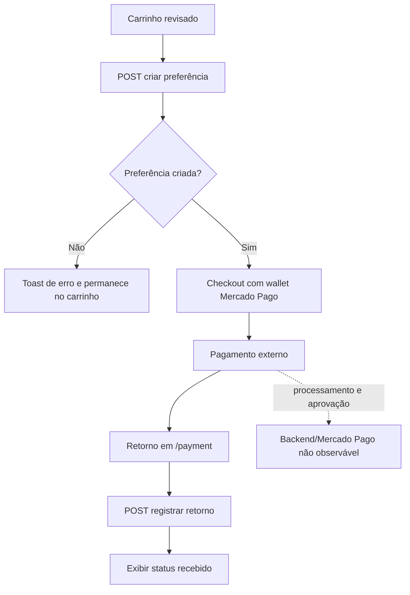
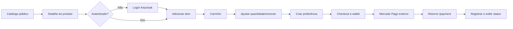
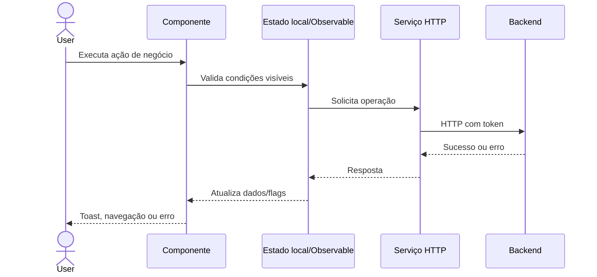

# Processos de Negócio Representados — Frontend

> Análise do projeto `ui-marketplace` realizada em 2026-09-19. Este documento descreve somente o que pode ser observado no frontend. Quando uma conclusão depender do backend, ela está marcada como **[A VALIDAR]** ou **[A VALIDAR NO BACKEND]**.

## 1. Sumário executivo

O frontend representa uma aplicação marketplace com quatro capacidades de negócio principais:

1. **Descobrir e selecionar produtos** em um catálogo público, consultar detalhes e adicionar itens ao carrinho.
2. **Preparar uma compra**, mantendo itens, quantidades e total do carrinho, e iniciar uma preferência de pagamento.
3. **Apresentar e registrar o retorno do pagamento** do Mercado Pago, após o checkout externo.
4. **Administrar produtos, imagens e usuários**, mediante acesso autenticado, além de consultar o próprio perfil e iniciar um fluxo OAuth.

A cadeia de valor observável é:

```text
Descoberta de produtos → Seleção → Carrinho → Checkout
                                      ↓
                           Preferência Mercado Pago
                                      ↓
                              Pagamento externo
                                      ↓
                         Retorno e registro do pagamento
```

O frontend não mostra pedido, entrega, estoque transacional, reembolso ou acompanhamento de pedido. A confirmação comercial da venda, a baixa de estoque e o processamento assíncrono do pagamento continuam no backend/Mercado Pago e não podem ser confirmados por este projeto.

## 2. Escopo e fontes analisadas

Foram analisados:

- `AGENTS.md`, `package.json`, `angular.json`, `src/app/app-routing.module.ts` e `src/app/app.module.ts`;
- módulos e componentes de catálogo, produto, carrinho, checkout, pagamento, usuário, perfil, cabeçalho e menu;
- serviços HTTP em `src/app/shared/service`;
- modelos de produto, carrinho, usuário, preferência, pagamento e imagem;
- ambientes/configurações sem reproduzir valores de autenticação ou certificados;
- templates HTML, mensagens, estados de tela, guards e redirecionamentos;
- testes existentes.

Não há backend, contrato OpenAPI/GraphQL, documentação funcional ou testes E2E disponíveis neste repositório. Os testes encontrados verificam criação de componentes e existência do interceptor, não jornadas de negócio.

## 3. Atores

| Ator identificado | Evidência | O que o frontend permite | Limitações da evidência |
|---|---|---|---|
| Visitante/cliente não autenticado | Rotas `catalog` e `catalog/:id` públicas; botão de login | Consultar catálogo e detalhe; iniciar adição ao carrinho | A adição exige login; não há cadastro público no frontend |
| Cliente autenticado | `AuthGuard`, `AuthService`, carrinho no cabeçalho, rotas `shopping-cart` e `checkout/:id` | Adicionar e manter itens, iniciar checkout, consultar dados próprios, sair | Não há tela de pedidos ou histórico |
| Usuário autenticado com acesso administrativo | Menu `Admin`, rotas protegidas de `user` e `list-product` | Listar, criar, editar e remover usuários/produtos conforme APIs | Nenhuma rota declara `data.roles`; o guard autentica, mas não restringe por papel neste projeto |
| Operador de produto/imagem | `EditProductComponent`, upload e `ImageService` | Manter dados de produto e associar imagens | O frontend não identifica explicitamente o papel responsável |
| Vendedor/proprietário de produto | `ProductService.listByUser`, `product.user`, token OAuth do usuário do produto | Listar produtos associados ao usuário e iniciar fluxo OAuth | A responsabilidade e as permissões efetivas dependem do backend |
| Mercado Pago | SDK Mercado Pago e retorno por query parameters | Renderizar wallet e receber resultado de pagamento | É ator externo; sua validação/processamento não está implementado no frontend |

### Autenticação e autorização

O Keycloak é inicializado com `check-sso`. Rotas protegidas redirecionam o usuário não autenticado para login e retornam à URL original. O `AuthGuard` contém suporte genérico a `route.data.roles`, mas as rotas atuais não configuram papéis. Portanto:

- **[FRONTEND]** autenticação é necessária para perfil, usuários, produtos, carrinho e checkout;
- **[A VALIDAR NO BACKEND]** qualquer distinção entre administrador, vendedor e cliente;
- **[A VALIDAR NO BACKEND]** autorização das operações CRUD e acesso aos recursos de outro usuário.

## 4. Mapa funcional

| Módulo | Objetivo de negócio | Atores | Principais ações | APIs/integrações |
|---|---|---|---|---|
| Acesso e identidade | Entrar, sair e consultar identidade | Visitante, usuário autenticado | Login, logout, consultar perfil, consultar usuário logado | Keycloak; `GET /users/queries/find-logged-user` |
| Catálogo | Descobrir produtos disponíveis | Visitante, cliente | Listar, pesquisar, paginar, visualizar detalhe | `GET /catalog`, `GET /catalog/{id}`, `GET /images/{productId}/product`, object storage |
| Carrinho | Registrar a seleção de compra | Cliente | Adicionar, adicionar se ausente, alterar quantidade, remover, consultar total | `POST /shopping-cart`, `POST /shopping-cart/createIfAbsent`, `PUT/DELETE /shopping-cart/{id}`, `GET /carts/user`, `GET /shopping-cart/count` |
| Checkout e pagamento | Preparar pagamento e receber retorno | Cliente, Mercado Pago | Criar preferência, carregar wallet, enviar pagamento externamente, registrar retorno | `POST /mercado-pago/preferences`, OAuth token, SDK Mercado Pago, `POST /mercado-pago/payments` |
| Administração de produtos | Manter oferta do marketplace | Usuário administrativo/vendedor | Criar, editar, remover, pesquisar produto, associar imagens | `/products`, `/images`, object storage |
| Administração de usuários | Manter usuários | Usuário administrativo | Criar, editar/consultar, remover, pesquisar usuário | `/users` |
| Integração OAuth | Iniciar autorização de provedor externo | Usuário administrativo/vendedor | Iniciar fluxo e seguir redirecionamento | `GET /oauth/start-flow`, URL externa retornada |

## 5. Mapa de navegação relevante

| Rota | Acesso | Objetivo funcional | Próximas etapas observadas |
|---|---|---|---|
| `/catalog` | Público | Pesquisar e selecionar produtos | `/catalog/:id`, `/shopping-cart` |
| `/catalog/:id` | Público | Consultar detalhe e imagens do produto | `/catalog`, `/shopping-cart` |
| `/shopping-cart` | Autenticado | Consultar e alterar seleção | `/catalog`, `/checkout/:preferenceId` |
| `/shopping-cart/:id` | Autenticado | Retomar adição de produto após login | `/shopping-cart` |
| `/checkout/:id` | Autenticado | Exibir carrinho e wallet Mercado Pago | `/shopping-cart`; retorno externo pode chegar a `/payment` |
| `/payment` | Sem `AuthGuard` | Receber parâmetros de retorno e registrar pagamento | `/catalog` |
| `/list-product` | Autenticado | Listar produtos do usuário | `/edit-product`, `/edit-product/:id` |
| `/edit-product` | Autenticado | Criar produto | volta à tela anterior |
| `/edit-product/:id` | Autenticado | Editar produto e imagens | volta à tela anterior |
| `/user` | Autenticado | Listar usuários | `/user/:id` |
| `/user/:id` | Autenticado | Consultar/editar usuário | inicia OAuth ou volta |
| `/view-logged-user` | Autenticado | Consultar dados do usuário autenticado | volta |
| `/profile` | Autenticado | Exibir claims do perfil | menu/header |
| `/home`, `/payment` | Público na configuração de rotas | Conteúdo auxiliar/retorno | depende da ação |

## 6. Jornadas do usuário

### UJ-001 — Descobrir e selecionar produto

**Ator:** visitante ou cliente. **Objetivo:** encontrar um produto e decidir adicioná-lo ao carrinho.

```text
Acessar /catalog
  → pesquisar ou paginar produtos
  → visualizar status de inventário e preço
  → abrir /catalog/:id
  → consultar descrição, avaliação e imagens
  → escolher “Add to Cart”
```

Evidência: `ListCatalogComponent`, `ViewProductComponent`, `CatalogService`, `ProductService`, `ImageService` e templates de catálogo.

### UJ-002 — Adicionar produto ao carrinho

**Ator:** visitante ou cliente. **Objetivo:** registrar uma unidade do produto na seleção.

```text
Selecionar “Add to Cart”
  → se não autenticado, redirecionar ao login com retorno /shopping-cart/{productId}
  → se autenticado, enviar produto e quantity = 1
  → receber item criado
  → atualizar contador do carrinho
  → mostrar confirmação
  → navegar para /shopping-cart
```

Na retomada pós-login, `/shopping-cart/:id` chama `createIfAbsent`; se `created` for falso, o item não é duplicado e o carrinho é recarregado.

### UJ-003 — Montar e revisar carrinho

**Ator:** cliente. **Objetivo:** ajustar a seleção antes do pagamento.

```text
Acessar carrinho
  → carregar carrinho do usuário e seus itens
  → pesquisar/paginar itens
  → alterar quantidade
  → remover item, se necessário
  → consultar total
  → escolher “Checkout”
```

### UJ-004 — Iniciar checkout e pagamento

**Ator:** cliente, com Mercado Pago como participante externo. **Objetivo:** preparar e realizar pagamento do carrinho.

```text
Escolher “Checkout”
  → POST /mercado-pago/preferences
  → navegar para /checkout/{preferenceId}
  → recarregar carrinho e total
  → obter token OAuth do usuário do produto
  → inicializar SDK Mercado Pago com publicKey
  → renderizar wallet usando preferenceId
  → cliente conclui pagamento fora do frontend
  → Mercado Pago redireciona para /payment com parâmetros
  → frontend registra o retorno
```

O frontend não mostra um formulário próprio de pagamento. Também não há polling, WebSocket ou refetch de status após o registro.

### UJ-005 — Administrar produto e imagens

**Ator:** usuário autorizado, papel não identificado explicitamente. **Objetivo:** publicar ou alterar uma oferta.

```text
Acessar /list-product
  → pesquisar/paginar produtos do usuário
  → criar novo ou abrir produto existente
  → informar campos do produto
  → opcionalmente fazer upload de imagem
  → salvar produto
  → em edição, associar imagens carregadas
  → mostrar confirmação e voltar
```

A tela de edição trata `id` como distinção entre criação e atualização. Não há validação de formulário explícita no template; campos exibidos não são suficientes para concluir obrigatoriedade.

### UJ-006 — Administrar usuários

**Ator:** usuário autenticado com autorização efetiva no backend. **Objetivo:** manter registros de usuários.

```text
Acessar /user
  → pesquisar/paginar usuários
  → criar novo ou abrir usuário existente
  → informar username, e-mail e nome
  → salvar ou remover
  → receber toast e retornar/recarregar lista
```

Há uma inconsistência de implementação: a tela de edição chama `UserService.create` mesmo quando acessada por `/user/:id`; a intenção de atualização existe no serviço (`PUT /users/{id}`), mas não é usada pelo componente observado.

### UJ-007 — Consultar identidade e perfil

**Ator:** cliente autenticado. **Objetivo:** visualizar seus dados de identidade.

```text
Abrir menu do usuário
  → escolher User ou Profile
  → carregar dados do Keycloak ou usuário logado
  → visualizar campos somente leitura
```

### UJ-008 — Autorizar integração externa

**Ator:** usuário que administra integração/venda. **Objetivo:** iniciar autorização OAuth.

```text
Abrir /user/{id}
  → escolher “Start Flow”
  → GET /oauth/start-flow
  → receber redirectUrl
  → navegador segue para o provedor externo
```

O resultado da autorização não é tratado neste frontend, além do possível retorno indicado pelo backend.

## 7. Macroprocessos e processos

### 7.1 Compra e pagamento

```text
MACROPROCESSO: Realizar compra
├── BP-001 Descobrir produto
├── BP-002 Adicionar item ao carrinho
├── BP-003 Ajustar carrinho
├── BP-004 Iniciar checkout
└── BP-005 Registrar retorno de pagamento
```

### 7.2 Oferta de produtos

```text
MACROPROCESSO: Gerir oferta
├── BP-006 Consultar produtos do usuário
├── BP-007 Criar produto
├── BP-008 Atualizar produto e imagens
└── BP-009 Remover produto
```

### 7.3 Administração e identidade

```text
MACROPROCESSO: Administrar acesso e cadastros
├── BP-010 Consultar usuário
├── BP-011 Criar usuário
├── BP-012 Remover usuário
├── BP-013 Consultar própria identidade
└── BP-014 Autorizar integração OAuth
```

## 8. Catálogo de processos

### BP-001 — Descobrir produto

- **Objetivo:** permitir que o usuário encontre uma oferta e avalie sua disponibilidade aparente.
- **Atores:** visitante, cliente.
- **Jornada:** UJ-001.
- **Gatilho:** acesso a `/catalog` ou `/catalog/{id}`.
- **Entrada:** página, tamanho, texto de busca e identificador do produto.
- **Fluxo:** listar catálogo → pesquisar/paginar → abrir detalhe → carregar imagens.
- **Decisões:** status `INSTOCK`, `LOWSTOCK` ou `NOSTOCK` altera a apresentação; `NOSTOCK` desabilita o botão de adicionar no catálogo.
- **APIs:** `GET /catalog`, `GET /catalog/{id}`, `GET /images/{productId}/product`, download em `/object-storage/download/{objectId}`.
- **Resultado:** produto e disponibilidade aparente exibidos. **[CONTINUA NO BACKEND — disponibilidade real não confirmada.]**
- **Evidência:** `list-catalog.component.ts`, `view-product.component.ts`, `catalog.service.ts`, `image.service.ts`.

### BP-002 — Adicionar item ao carrinho

- **Objetivo:** registrar uma unidade de produto no carrinho do cliente.
- **Atores:** visitante/cliente.
- **Jornada:** UJ-002.
- **Pré-condição:** produto conhecido; autenticação necessária para a operação.
- **Entrada:** `{ productId, quantity: 1 }`.
- **Fluxo:** verificar login → redirecionar ao login se necessário → `POST /shopping-cart` → atualizar contador → toast → abrir carrinho.
- **Exceções:** falha de API mantém o usuário na tela e encerra o estado de saving; interceptor mostra erro.
- **Resultado:** item criado e carrinho aberto. **[FRONTEND]**
- **Evidência:** `ListCatalogComponent.addCartItem`, `ViewProductComponent.addCartProduct`, `ShoppingCartService.create`.

### BP-003 — Ajustar carrinho

- **Objetivo:** manter a seleção e o total antes do checkout.
- **Atores:** cliente.
- **Jornada:** UJ-003.
- **Entrada:** carrinho do usuário; item e nova quantidade; item a remover.
- **Operações:** `GET /carts/user`, `GET /shopping-cart`, `PUT /shopping-cart/{id}`, `DELETE /shopping-cart/{id}`, `GET /shopping-cart/count`.
- **Decisões:** pesquisa é aplicada após debounce de 500 ms; mudança repetida para o mesmo item/quantidade não dispara nova atualização; erro de leitura retorna ao catálogo.
- **Resultado:** itens e total são recarregados; contador é atualizado em criação/remoção.
- **Lacuna:** o frontend não valida mínimo/máximo de quantidade nem estoque disponível. **[A VALIDAR NO BACKEND]**
- **Evidência:** `list-shopping-cart-item.component.ts/html`, `shopping-cart.service.ts`, `cart.service.ts`.

### BP-004 — Iniciar checkout

- **Objetivo:** criar a preferência que permite ao cliente iniciar o pagamento.
- **Atores:** cliente, Mercado Pago/backend.
- **Jornada:** UJ-004.
- **Gatilho:** botão `Checkout` do carrinho.
- **Fluxo:** `POST /mercado-pago/preferences` com corpo vazio → receber `Preference.id` → navegar para `/checkout/{id}`.
- **Decisões:** falha impede navegação e encerra `checkingOut`; não existe validação visual de carrinho vazio antes da chamada.
- **Resultado:** preferência criada e wallet preparada na tela seguinte. **[FRONTEND]**
- **Lacuna:** não é possível confirmar se carrinho vazio, preço, estoque ou vendedor são validados pelo backend. **[A VALIDAR NO BACKEND]**

### BP-005 — Registrar retorno de pagamento

- **Objetivo:** persistir e exibir o resultado devolvido pelo Mercado Pago.
- **Atores:** cliente, Mercado Pago, backend.
- **Jornada:** UJ-004.
- **Gatilho:** entrada em `/payment` com query parameters.
- **Entrada:** `payment_id`, `status`, `merchant_order_id`, `external_reference` e detalhes de coleção/preferência.
- **Fluxo:** mapear parâmetros → `POST /mercado-pago/payments` → exibir payment id, status, referência e merchant order id.
- **Resultado:** retorno registrado, se a API aceitar. **[CONTINUA NO BACKEND]**
- **Exceções:** erro é mostrado pelo interceptor; não há retry nem tela de falha específica.
- **Lacunas:** os parâmetros vêm da URL e não há verificação visível de assinatura/origem. **[A VALIDAR NO BACKEND]**

### BP-006 — Consultar produtos do usuário

- **Objetivo:** listar a oferta atribuída ao usuário operador/vendedor.
- **Atores:** usuário autenticado.
- **Jornada:** UJ-005.
- **API:** `GET /products/user`, com paginação e busca.
- **Resultado:** lista paginada com acesso à edição e remoção.
- **Evidência:** `ListProductComponent`, `ProductService.listByUser`.

### BP-007 — Criar produto

- **Objetivo:** registrar uma nova oferta.
- **Atores:** usuário autorizado.
- **Jornada:** UJ-005.
- **Entrada visível:** id somente leitura quando existente; nome, descrição, preço, quantidade, usuário/status/categoria e metadados conforme template.
- **API:** `POST /products`.
- **Resultado:** toast `Product Created` e retorno à tela anterior.
- **Lacunas:** obrigatoriedade, faixa de preço, quantidade, associação do usuário e transação da imagem não são validadas no frontend. **[A VALIDAR NO BACKEND]**

### BP-008 — Atualizar produto e imagens

- **Objetivo:** alterar uma oferta existente e associar uploads.
- **APIs:** `GET /products/{id}`, `PUT /products/{id}`, `GET /images/{productId}/product`, `POST /images` e upload configurado no template.
- **Fluxo:** carregar produto/imagens → editar → upload retorna `objectId`/metadados → alterar referência visual → salvar produto → criar registros de imagem para uploads → mostrar confirmações → voltar.
- **Resultado:** produto atualizado e imagens associadas, se todas as operações forem aceitas.
- **Lacuna:** chamadas de imagem são aninhadas e não há transação/rollback visível; o componente pode voltar antes de concluir todos os uploads. **[A VALIDAR NO BACKEND]**

### BP-009 — Remover produto

- **Objetivo:** retirar uma oferta da lista do usuário.
- **API:** `DELETE /products/{id}`.
- **Fluxo:** clicar no ícone de remoção → chamar API → toast `Product Deleted` → recarregar lista.
- **Lacuna:** não há confirmação modal nem regra de dependência com carrinho/pedidos visível. **[A VALIDAR NO BACKEND]**

### BP-010 — Consultar usuário

- **Objetivo:** localizar e visualizar um registro de usuário.
- **Atores:** usuário autenticado com permissão efetiva.
- **API:** `GET /users`, `GET /users/{id}`.
- **Resultado:** tabela paginada ou detalhe com username, e-mail, nome e metadados.

### BP-011 — Criar usuário

- **Objetivo:** cadastrar usuário administrativo/operacional.
- **API:** `POST /users` via `EditUserComponent.save`.
- **Resultado:** toast `User Created` e retorno.
- **Lacuna:** não há validação de formato/obrigatoriedade no frontend. **[A VALIDAR NO BACKEND]**

### BP-012 — Remover usuário

- **Objetivo:** excluir um usuário da administração.
- **API:** `DELETE /users/{id}`.
- **Resultado:** toast `User Deleted` e recarga da lista.
- **Lacuna:** não há confirmação, tratamento de dependências ou regra de proteção do próprio usuário visível. **[A VALIDAR NO BACKEND]**

### BP-013 — Consultar própria identidade

- **Objetivo:** exibir dados do usuário autenticado.
- **APIs:** `GET /users/queries/find-logged-user` e claims carregadas do Keycloak.
- **Resultado:** tela somente leitura em `/view-logged-user` ou `/profile`.

### BP-014 — Autorizar integração OAuth

- **Objetivo:** obter autorização de provedor externo para o fluxo do usuário/produto.
- **API:** `GET /oauth/start-flow`.
- **Resultado:** navegador segue `redirectUrl`; conclusão externa não é observável.
- **Classificação:** **[FRONTEND]**, com continuidade **[CONTINUA NO BACKEND/PROVEDOR EXTERNO]**.

## 9. Regras de negócio aparentes

| ID | Regra/condição observada | Classificação | Processos |
|---|---|---|---|
| BR-001 | Rotas de perfil, usuários, produtos, carrinho e checkout exigem autenticação | [FRONTEND] | BP-002–BP-014 |
| BR-002 | Visitante que tenta adicionar item é enviado ao login e retorna ao carrinho do produto | [FRONTEND] | BP-002 |
| BR-003 | Produto `NOSTOCK` não habilita adicionar ao carrinho no catálogo | [FRONTEND] / [A VALIDAR NO BACKEND] | BP-001/BP-002 |
| BR-004 | Adição pós-login usa `createIfAbsent` e evita duplicação aparente | [FRONTEND] | BP-002 |
| BR-005 | Quantidade enviada na primeira adição é 1 | [FRONTEND] | BP-002 |
| BR-006 | Carrinho é identificado pelo usuário autenticado | [INFERIDO] | BP-003/BP-004 |
| BR-007 | Checkout depende de uma preferência criada no backend | [FRONTEND] | BP-004 |
| BR-008 | Wallet usa public key do usuário associado ao primeiro item carregado | [FRONTEND] / [A VALIDAR NO BACKEND] | BP-004 |
| BR-009 | Status de pagamento exibido é o recebido nos parâmetros de retorno | [FRONTEND] | BP-005 |
| BR-010 | Produto pode ter imagens associadas por upload e registro posterior | [FRONTEND] | BP-008 |
| BR-011 | O serviço suporta `PUT /users/{id}`, mas a tela de edição usa `POST /users` | [FRONTEND — INCONSISTÊNCIA] | BP-010/BP-011 |
| BR-012 | Papéis de acesso são suportados pelo guard, mas nenhuma rota declara papéis | [FRONTEND] | BP-006–BP-012 |

Nenhuma dessas regras é prova isolada da regra definitiva do domínio. As que limitam estoque, quantidade, autorização, pagamento ou exclusão precisam ser confirmadas no backend.

## 10. Estados e ciclos de vida

### Estados de domínio observados

| Domínio | Estados/indicadores | Observação |
|---|---|---|
| Produto/estoque | `INSTOCK`, `LOWSTOCK`, `NOSTOCK` | Apenas apresentação e habilitação do botão; não há transição implementada |
| Carrinho | existente, carregando, item criado, item ausente/criado, atualizado, removido | O frontend recarrega a representação após operações |
| Pagamento | `status` recebido por query parameter | Não há enum nem ciclo de vida local |
| Preferência | `preference.id` | Identificador usado para inicializar wallet |
| Usuário | autenticado/não autenticado | Estado fornecido pelo Keycloak |

### Estados de interface não negociais

`loading`, `saving`, `creating`, `updating`, `removing`, `checkingOut`, `loadingToken`, skeletons e visibilidade de menu são estados de UX e não devem ser tratados como estados do domínio.

### Ciclo de pagamento observável



## 11. APIs e integrações relacionadas aos processos

| Operação | Ação de negócio | Gatilho | Entrada | Sucesso | Erro/estado posterior |
|---|---|---|---|---|---|
| `GET /catalog` | pesquisar catálogo | carregamento, busca ou paginação | `page`, `size`, `search` | lista paginada | interceptor mostra toast |
| `GET /catalog/{id}` | abrir detalhe | seleção de produto | `id` | produto | detalhe permanece sem dados |
| `POST /shopping-cart` | adicionar item | botão de adicionar autenticado | `productId`, `quantity` | item, contador e navegação | erro e `saving=false` |
| `POST /shopping-cart/createIfAbsent` | retomar adição sem duplicar | entrada em `/shopping-cart/{id}` | `productId`, `quantity` | `created`, item, recarga | erro e estado de criação |
| `PUT /shopping-cart/{id}` | alterar quantidade | mudança no controle | `quantity` | item atualizado e toast | erro e `updating=false` |
| `DELETE /shopping-cart/{id}` | remover item | ícone de lixeira | `id` | recarga, contador e toast | erro e `removing=false` |
| `GET /carts/user` | consultar carrinho | entrada em carrinho/checkout | identidade do token | carrinho/total | volta ao catálogo ou carrinho |
| `POST /mercado-pago/preferences` | iniciar checkout | botão Checkout | `{}` | id da preferência | permanece no carrinho |
| `GET /oauth-tokens/user/{id}` | obter credencial da wallet | primeiro item do checkout | id do proprietário | token/public key | volta ao carrinho |
| SDK Mercado Pago `wallet` | exibir pagamento | token carregado | `preferenceId`, public key | wallet renderizada | apenas callbacks de log |
| `POST /mercado-pago/payments` | registrar retorno | entrada em `/payment` | query parameters mapeados | pagamento exibido | toast de erro |
| `GET/POST/PUT/DELETE /products...` | manter oferta | telas de produto | entidade/paginação/id | lista ou produto | toast/interceptor |
| `GET/POST/DELETE /users...` | manter usuários | telas de usuário | entidade/paginação/id | lista ou usuário | toast/interceptor |
| `GET/POST /images...` | consultar/associar imagens | detalhe/edição de produto | produto e metadados do upload | imagens associadas | toast/interceptor |
| `GET /oauth/start-flow` | iniciar autorização | Start Flow | nenhum visível | redirect URL | não há fluxo local de erro específico |

## 12. Exception paths

### Compra e carrinho

- Usuário não autenticado: login é iniciado com URL de retorno; **[FRONTEND]**.
- Produto sem estoque aparente: botão desabilitado no catálogo; o detalhe não mostra a mesma desabilitação de forma evidente. **[INCONSISTÊNCIA/A VALIDAR]**.
- Falha ao adicionar/alterar/remover: interceptor extrai `error` ou `message`, mostra toast e a operação não avança.
- Falha ao carregar carrinho: a tela chama `back()` para o catálogo no carrinho; no checkout, volta ao carrinho.
- Item já existente na retomada pós-login: resposta `created=false`; o carrinho é apenas recarregado.
- Carrinho vazio: nenhuma condição local impede `Checkout`; comportamento real depende do backend. **[A VALIDAR NO BACKEND]**.

### Checkout e pagamento

- Falha ao criar preferência: usuário permanece no carrinho.
- Falha ao obter token OAuth: checkout volta ao carrinho.
- Ausência de `publicKey`: wallet não é criada e não há mensagem específica.
- Retorno com parâmetros ausentes ou inválidos: valores são convertidos para `Number`/strings anuláveis e enviados; validação não é visível. **[A VALIDAR NO BACKEND]**.
- Recusa, cancelamento, expiração ou aprovação do pagamento: não há telas/branches específicas implementadas; somente o `status` de retorno é exibido.

### Administração

- Falha de CRUD: toast global de erro; tela não apresenta recuperação específica.
- Exclusão: não há modal de confirmação.
- Upload sem corpo de resposta: toast `File upload response body cannot be empty` e nenhuma associação é criada para aquele upload.
- Edição de usuário existente: intenção e operação estão desalinhadas (`POST` usado em vez do `PUT` disponível). **[VALIDAR/CORRIGIR]**.

## 13. Testes como evidência

Os testes encontrados são:

| Área | Cenário | Evidência |
|---|---|---|
| App | componente é criado; título `Marketplace` | `src/app/app.component.spec.ts` |
| Home | componente é criado | `home.component.spec.ts` |
| Página não encontrada | componente é criado | `page-not-found.component.spec.ts` |
| Sidebar | componente é criado | `sidebar.component.spec.ts` |
| Interceptor | serviço pode ser instanciado | `error-http-interceptor.service.spec.ts` |

Não há **[TESTADO]** para checkout, carrinho, pagamento, CRUD, autenticação, estoque ou exceções. As jornadas e processos deste documento são, portanto, principalmente **[FRONTEND]** e **[INFERIDO]**, não comprovados por testes de integração.

## 14. Matriz de rastreabilidade

| Processo | Jornada | Rota/página | Ação/componente | Estado | API/serviço | Teste |
|---|---|---|---|---|---|---|
| BP-001 | UJ-001 | `/catalog`, `/catalog/:id` | pesquisar, detalhe, imagens | inventoryStatus, loading | Catalog/Product/Image | Não localizado |
| BP-002 | UJ-002 | catálogo/carrinho | Add to Cart | saving, count$ | `ShoppingCartService.create` | Não localizado |
| BP-003 | UJ-003 | `/shopping-cart` | quantidade, remover, Checkout | cart, updating, removing | Cart/ShoppingCart | Não localizado |
| BP-004 | UJ-004 | `/shopping-cart` → `/checkout/:id` | Checkout | checkingOut, preferenceId | PreferenceService | Não localizado |
| BP-005 | UJ-004 | `/payment` | retorno Mercado Pago | payment.status, saving | PaymentService | Não localizado |
| BP-006 | UJ-005 | `/list-product` | listar/pesquisar | page, loading | ProductService.listByUser | Não localizado |
| BP-007 | UJ-005 | `/edit-product` | Save | product, saving | ProductService.create | Não localizado |
| BP-008 | UJ-005 | `/edit-product/:id` | upload/Save | images, uploadedFiles | Product/Image services | Não localizado |
| BP-009 | UJ-005 | `/list-product` | remover | removing | ProductService.delete | Não localizado |
| BP-010 | UJ-006 | `/user`, `/user/:id` | pesquisar/detalhe | page, loading | UserService.list/get | Não localizado |
| BP-011 | UJ-006 | `/user` | New/Save | user, saving | UserService.create | Não localizado |
| BP-012 | UJ-006 | `/user` | remover | removing | UserService.delete | Não localizado |
| BP-013 | UJ-007 | `/view-logged-user`, `/profile` | consulta | userProfile, user$ | UserService/Keycloak | Não localizado |
| BP-014 | UJ-008 | `/user/:id` | Start Flow | redirectUrl | OAuthService | Não localizado |

## 15. Lacunas, inconsistências e código aparentemente obsoleto

### Frontend sem operação ou conclusão observável

- Não existe tela de pedido, confirmação de pedido, entrega, reembolso ou histórico.
- Não existe operação explícita de criação de pedido; o pedido pode ser criado dentro da preferência/checkout no backend, mas isso não é demonstrável aqui.
- `PaymentComponent` registra o retorno, mas não acompanha alteração posterior de status.

### API/serviço sem jornada ativa claramente identificada

- `CartItemService` e operações CRUD genéricas de `CartService` não são usadas pelas telas principais observadas.
- `AuthorizationService` usa Auth0, enquanto o app inicializa Keycloak; não há uso encontrado na jornada ativa e pode ser legado.
- `ImageService` expõe CRUD completo, mas a UI usa principalmente consulta por produto e criação após upload.
- `OAuthService.startFlow` é usado, mas o retorno do fluxo não é processado neste projeto.

### Inconsistências funcionais

- `EditUserComponent.save()` sempre chama `UserService.create`; a edição de `/user/:id` não chama `update`.
- `ViewProductComponent` não desabilita explicitamente `Add to Cart` conforme `NOSTOCK`, embora o catálogo desabilite.
- `/payment` não tem `AuthGuard`, embora registre uma operação sensível de pagamento.
- O contador é atualizado em criação/remoção, mas não há `count()` após alteração de quantidade.
- O primeiro item do carrinho determina o usuário cujo token/public key é usado no checkout; a compatibilidade de múltiplos vendedores não é tratada.
- Alguns nomes e contratos aparentam ser gerados/legados (`cartSubject$` usado para Payment, serviço Auth0 paralelo). Não devem ser interpretados como processos adicionais sem confirmação.

## 16. Validações necessárias no backend

1. Confirmar papéis e permissões para CRUD de usuários/produtos, leitura de carrinho e uso de OAuth.
2. Confirmar que `NOSTOCK` é regra de venda e não somente apresentação.
3. Validar estoque e disponibilidade novamente no backend ao adicionar, atualizar carrinho e criar preferência.
4. Definir quantidade mínima/máxima e comportamento para quantidade zero/negativa.
5. Confirmar se `createIfAbsent` é idempotente e qual é o comportamento concorrente.
6. Confirmar quando o pedido é criado e quais estados existem antes/depois do pagamento.
7. Confirmar autoridade dos query parameters de retorno do Mercado Pago, idempotência de `POST /mercado-pago/payments` e verificação de assinatura/origem.
8. Confirmar tratamento de pagamento aprovado, pendente, recusado, cancelado e expirado.
9. Confirmar transação/rollback entre upload de arquivo, criação de imagem e atualização de produto.
10. Confirmar dependências e proteção contra exclusão de produtos/usuários relacionados a carrinhos ou pedidos.
11. Confirmar se o `PUT /users/{id}` deve ser usado na tela de edição e se `POST /users` é somente criação.
12. Confirmar se o checkout suporta carrinho com itens de vendedores diferentes.

## 17. Diagramas de síntese

### Jornada cliente → pagamento



### Processo observável de uma operação



## 18. Glossário

| Termo | Significado observável |
|---|---|
| Catálogo | Consulta pública de produtos em `/catalog` |
| Produto | Oferta com nome, descrição, preço, quantidade, status de inventário e imagens |
| Carrinho | Seleção persistida para o usuário autenticado |
| Cart item | Linha do carrinho com produto, preço, quantidade e total |
| Preference | Identificador retornado para inicializar a wallet do Mercado Pago |
| Wallet | Componente de checkout renderizado pelo SDK Mercado Pago |
| Payment | Retorno de pagamento e seus dados de merchant/collection |
| `createIfAbsent` | Operação usada para evitar duplicação aparente na retomada após login |
| `inventoryStatus` | Indicador visual `INSTOCK`, `LOWSTOCK` ou `NOSTOCK` |
| `Start Flow` | Início de autorização OAuth com redirecionamento externo |

## 19. Classificação geral das descobertas

- **[DOCUMENTADO]:** estrutura, rotas, modelos, serviços e convenções descritos no `AGENTS.md`.
- **[FRONTEND]:** ações, chamadas, redirecionamentos, estados locais e mensagens efetivamente implementados.
- **[TESTADO]:** somente criação de componentes e existência do interceptor, conforme testes encontrados.
- **[INFERIDO]:** cadeia de valor de compra e associação entre catálogo, carrinho, preferência e pagamento.
- **[A VALIDAR]:** significado definitivo de papéis, regras de estoque, estados de pagamento e conclusão do pedido.
- **[A VALIDAR NO BACKEND]:** todas as regras de segurança, idempotência, consistência, estoque, autorização, pagamento e transações.

Este documento deve ser atualizado quando o backend, contratos de API, requisitos ou testes E2E forem disponibilizados.
